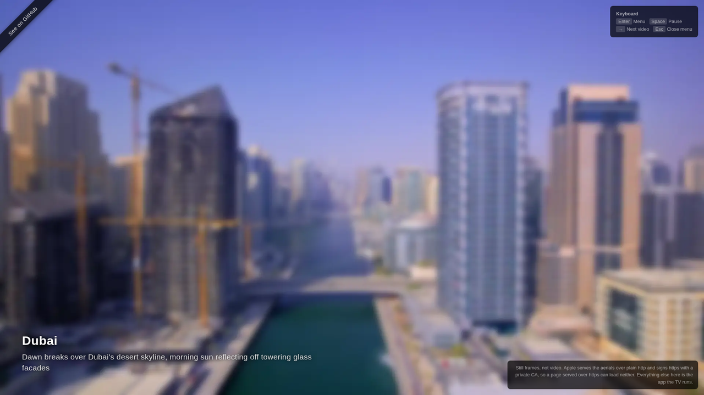

# Aerial for Samsung Tizen TV

[](https://github.com/jeancarlos/aerial-tizen/actions/workflows/ci.yml)
[](https://github.com/jeancarlos/aerial-tizen/actions/workflows/security.yml)
[](https://scorecard.dev/viewer/?uri=github.com/jeancarlos/aerial-tizen)
[](https://www.bestpractices.dev/projects/15610)
[](https://github.com/jeancarlos/aerial-tizen/actions/workflows/ci.yml)
[](https://github.com/jeancarlos/aerial-tizen/releases/latest)
[](https://aerial.jeansouza.dev/)
[](LICENSE)
[](https://reuse.software/)
[](#requirements)
[](package.json)

Apple TV's aerial screensavers, running natively on a Samsung TV. 115 videos streamed from Apple's CDN and decoded in hardware as HEVC 4K through Samsung's AVPlay.

[**Try the demo**](https://aerial.jeansouza.dev/) - the real app in your browser, no TV needed.



| Category | Videos |
|---|---:|
| Space | 22 |
| Sea | 21 |
| Landscape | 42 |
| Cityscape | 30 |

Each video fades into the next and shows its title and description while it loads.

## Requirements

- A Samsung Smart TV on Tizen 6.0 or newer, which means a 2021 model or later.
- A PC on the same network segment as the TV.
- Either Docker, or the [Tizen Studio CLI](https://developer.tizen.org/development/tizen-studio/download).

You do not need a Samsung developer account. The TV accepts a package signed with the public distributor certificate that ships with Tizen Studio, and that is what the instructions below use.

## Quick start

1. Turn on developer mode on the TV and note its address (steps below).
2. Run `./tvdeploy.sh --tv <TV address>` in a clone of this repository, or follow the Docker or Tizen Studio steps.
3. Open the app on the TV. The first video starts within a few seconds.

To remove it, uninstall Aerial from the TV's apps list, or run `sdb -s <TV address>:26101 uninstall` with the app id from `config.xml`. Nothing else is left on the TV or the PC.

## Install

### 1. Turn on developer mode

On the TV: open Apps, type `12345` on the remote, turn Developer mode on, enter your PC's IP address, and restart the TV.

### 2. Find the TV's address

Check your router's DHCP leases, or scan for the sdb port:

```bash
nmap -p 26101 --open 192.168.0.0/24
```

Check it again if anything times out later. DHCP renewal moves the address, and a stale one looks exactly like a TV that is switched off.

### 3. Deploy with Docker

Nothing to install locally.

```bash
docker run --rm --network=host -v "$PWD:/app:ro" vitalets/tizen-webos-sdk bash -lc '
  TV=<tv-ip>:26101
  sdb connect $TV
  DEVICE=$(sdb devices | awk "NR>1 {print \$3; exit}")

  STAGE=/tmp/stage; mkdir -p $STAGE/js $STAGE/css
  cp /app/config.xml /app/icon.png /app/index.html $STAGE/
  cp /app/css/style.css $STAGE/css/
  for n in catalog storage telemetry settings player menu debug main; do cp /app/js/$n.js $STAGE/js/; done
  [ -f /app/js/local-config.js ] && cp /app/js/local-config.js $STAGE/js/
  cp -r /app/preload $STAGE/preload

  tizen package -t wgt -s dev -- $STAGE
  mv "$STAGE/Aerial Screensaver.wgt" $STAGE/aerial.wgt
  tizen install -n aerial.wgt -t $DEVICE -- $STAGE
  tizen run -p AerialScr0.AerialScreensaver -t $DEVICE
'
```

The image carries a working `dev` signing profile, so there is no certificate to set up. `js/local-config.js` is optional and only exists if you have set up your own video server or telemetry, both covered in [DEVELOPMENT.md](DEVELOPMENT.md).

Do not run `tizen cli-config profiles.path=...`. It breaks profile resolution and packaging then fails with an unhelpful message.

### 4. Or deploy with a local Tizen Studio

```bash
./setup.sh     # asks for the Tizen Studio path, TV address and profile, writes .env
./deploy.sh    # stages the runtime files, packages, installs, launches
```

## Using it

| Key | Action |
|---|---|
| `Enter` | Open settings |
| `→`, `Fast Forward`, `Ch+`, `Ch−` | Next video |
| `Play`, `Pause`, `Play-Pause` | Pause and resume |
| `Back`, `Stop` | Exit |

In the settings menu, `↑` and `↓` move, `←` and `→` change a value, `Enter` toggles, and `Back` closes.

| Setting | Values | Notes |
|---|---|---|
| Show Description | On, Off | The title and description overlay |
| Description Timer | 1-15s | How long the overlay stays up |
| Video Order | Shuffle, Sequential | Shuffle never repeats the video that just played |
| Category | All, Space, Sea, Landscape, Cityscape | Changing it restarts playback in the new category |

Settings and the last video played survive a reboot.

## Troubleshooting

**`install failed[118, -11] Author certificate not match`** - a build signed with a different certificate is already installed. Remove it and install again. This clears the app's stored settings.

```bash
sdb -s <tv-ip>:26101 uninstall AerialScr0
```

Use `sdb` for this. `tizen uninstall` and `vd_uninstallapp` fail silently here. Keep your author certificate after the first install and you will not hit this again.

**Every command times out** - the TV's address changed. Repeat step 2.

**Packaging fails with "An error has occurred"** - look in `~/tizen-studio-data/cli/logs/cli.log`. A `profiles.path` entry in the CLI config is the usual cause.

**A video never starts** - the app retries the video on its own and moves to the next one when it runs out of options, so a single bad file costs you nothing but a pause. If every video fails, the catalog is likely stale; open an issue.

## Verify a release

Every release archive is signed with cosign using GitHub's keyless identity. Download the `.zip` and its `.zip.sigstore.json` from the release, then:

```bash
cosign verify-blob --bundle aerial-tizen-vX.Y.Z.zip.sigstore.json \
  --certificate-identity https://github.com/jeancarlos/aerial-tizen/.github/workflows/release.yml@refs/tags/vX.Y.Z \
  --certificate-oidc-issuer https://token.actions.githubusercontent.com \
  aerial-tizen-vX.Y.Z.zip
```

## Development

[DEVELOPMENT.md](DEVELOPMENT.md) covers running the app without a TV, the developer menu and on-screen debug board, playing from your own LAN server, telemetry, and how the player recovers from failures. [CONTRIBUTING.md](CONTRIBUTING.md) covers the constraints a patch has to respect.

## Thanks

Inspired by [xscreensaver-aerial](https://github.com/graysky2/xscreensaver-aerial) by graysky2.

## Author

Jean Souza - [jeansouza.dev](https://jeansouza.dev) · [github.com/jeancarlos](https://github.com/jeancarlos)

## Trademarks

Apple, Apple TV and Aerial are trademarks of Apple Inc. Samsung and Smart TV are trademarks of Samsung Electronics Co., Ltd. Tizen is a trademark of the Linux Foundation. This project is independent: it is not affiliated with, endorsed by or sponsored by Apple, Samsung or the Linux Foundation, and it uses their names only to say what it works with.

The videos belong to Apple and are streamed from Apple's public CDN. The repository contains no Apple footage: the transition thumbnails are cut on your own machine by `tools/make-thumbs.sh`.

## License

MIT. Copyright (c) 2026 Jean.

Apple's aerial videos belong to Apple. This app streams them from their public CDN.
